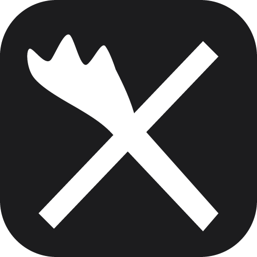
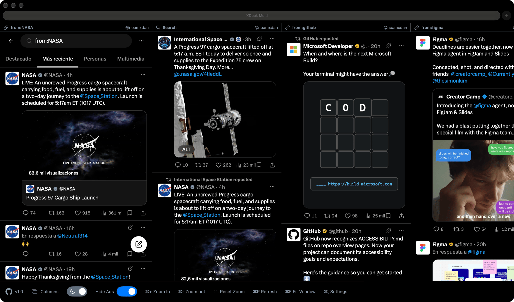
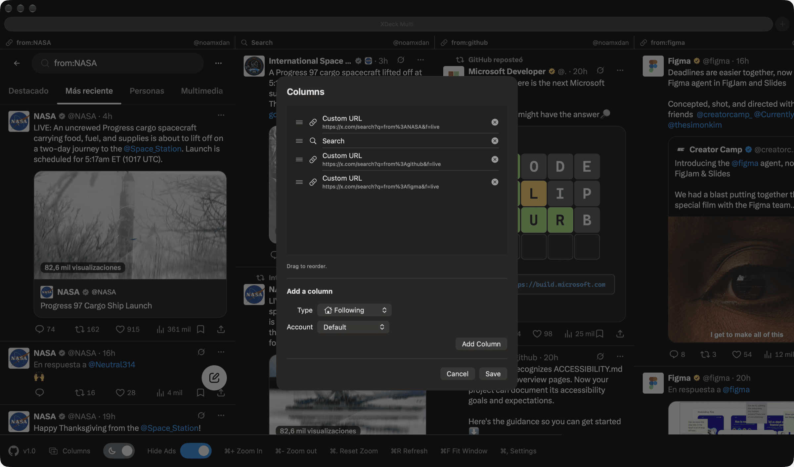
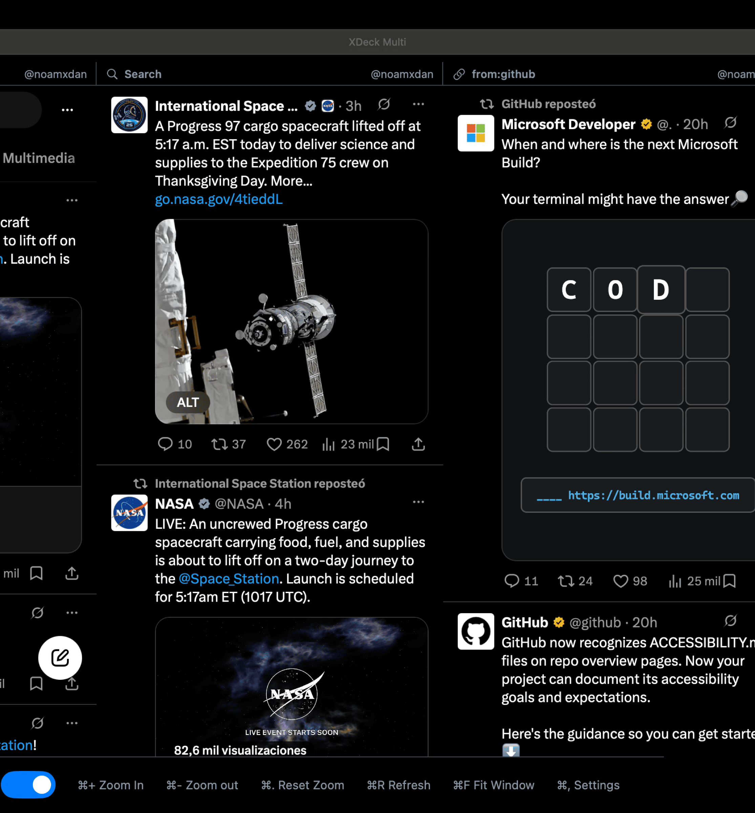

<div align="center">
  
  <h1>XDeck Multi</h1>
  <p><b>Un cliente de 𝕏 estilo TweetDeck para macOS, Windows y Linux, con varias cuentas en la misma ventana.</b></p>
  <p><a href="README.md">English</a> · <b>Español</b></p>
  <a href="https://github.com/danielcamposlozada/XDeck-Multi/releases/latest"></a>
  
  <a href="https://github.com/danielcamposlozada/XDeck-Multi/actions/workflows/ci.yml"></a>
  <a href="LICENSE"></a>
  <br><br>
  
</div>

> [!NOTE]
> XDeck Multi es un fork de [XDeck](https://github.com/morishin/XDeck), de [Shintaro Morikawa](https://github.com/morishin). Le suma varias cuentas, un editor de columnas, una columna de búsqueda y una edición para Windows y Linux.

## ¿Por qué XDeck Multi?

- **TweetDeck ya no está para la mayoría.** X Pro necesita un plan pago. XDeck Multi muestra tu timeline, notificaciones, listas y búsquedas lado a lado con una cuenta gratis.
- **Una ventana para todas tus cuentas.** La personal y la del trabajo tienen cada una sus columnas, su sesión y su botón para postear. Sin cerrar sesión y volver a entrar.
- **Sin claves de API ni servidores.** Cada columna es x.com, así que todo lo que ofrece X sigue funcionando, y tus datos solo van a X.

## Funciones

### Columnas
- Para ti, Siguiendo, Notificaciones, Perfil, Búsqueda y cualquier página de 𝕏 (una lista, una búsqueda, una comunidad).
- Botón **Columns**: agregá, quitá y reordená columnas arrastrándolas. Los cambios se ven al instante (macOS).
- Una barra de título en cada columna con su tipo y su cuenta (macOS).
- Al abrir una foto o un video, esa columna ocupa toda la ventana.

### Varias cuentas
- Cada columna puede usar una cuenta de 𝕏 distinta.
- Cada cuenta tiene su propia sesión, aislada y guardada.
- Inicio de sesión guiado, de a una cuenta, con la opción "Skip for now" para dejarla para después.
- La primera columna de cada cuenta conserva el botón para postear, así siempre publicás desde la cuenta correcta.

### Lectura
- Ocultá anuncios y posts promocionados con un interruptor.
- Modo claro y oscuro.
- Zoom y recarga de todas las columnas a la vez.
- La barra de navegación de celular de 𝕏 está oculta, así las columnas angostas muestran solo posts.

## Galería

#### Agregar y reordenar columnas


#### Búsquedas como columnas


## Instalación

Descargá el archivo para tu sistema desde la [última versión](https://github.com/danielcamposlozada/XDeck-Multi/releases/latest).

| Sistema | Archivo |
|---|---|
| macOS 13.3 o posterior (Apple silicon e Intel) | `XDeck-Multi-<versión>-macOS.zip` |
| Windows 10 o posterior | `XDeck-Multi-Setup-<versión>.exe` |
| Linux (x86-64) | `XDeck-Multi-<versión>-x86_64.AppImage` o `xdeck-multi_<versión>_amd64.deb` |

### Primera apertura

Las apps no están firmadas por Apple ni por Microsoft, así que la primera vez hay que hacer un paso más.

- **macOS:** descomprimí el archivo y mové **XDeck Multi** a Aplicaciones. Abrila una vez, andá a **Ajustes del Sistema → Privacidad y seguridad** y hacé clic en **Abrir igualmente**.
- **Windows:** si SmartScreen muestra "Windows protegió su PC", hacé clic en **Más información → Ejecutar de todas formas**.
- **Linux (AppImage):** hacelo ejecutable con `chmod +x XDeck-Multi-*.AppImage` y abrilo. En Ubuntu 24.04 y Linux Mint 22 necesita FUSE 2: `sudo apt install libfuse2t64`.
- **Linux (.deb):** `sudo apt install ./xdeck-multi_*_amd64.deb`.

## Uso

### Atajos de teclado

En Windows y Linux, usá Ctrl en lugar de ⌘.

| Atajo | Acción |
|---|---|
| ⌘ + / ⌘ − | Acercar / alejar |
| ⌘ . | Zoom normal |
| ⌘ R | Recargar todas las columnas |
| ⌘ F | Ajustar la ventana a las columnas |
| ⌘ , | Abrir la carpeta de configuración |

### Configuración

En macOS, el botón **Columns** sirve para agregar, quitar y reordenar columnas. Todo lo demás está en `settings.json`: apretá ⌘, para abrir su carpeta, editá el archivo y reiniciá la app.

```json
{
  "$schema": "./schema.json",
  "columnWidth": 400,
  "columns": [
    { "type": "forYou" },
    { "type": "search" },
    { "type": "custom", "url": "https://x.com/i/lists/123456789" },
    { "type": "following", "account": "trabajo" },
    { "type": "notifications", "account": "trabajo" }
  ]
}
```

| Campo | Qué hace |
|---|---|
| `columnWidth` | Ancho de cada columna en puntos. Si no está, las columnas se reparten el ancho de la ventana. |
| `type` | `forYou`, `following`, `notifications`, `profile`, `search` o `custom`. |
| `url` | Para las columnas `custom`: cualquier dirección web, como una lista o una búsqueda. |
| `account` | Nombre opcional de la cuenta de 𝕏 de esa columna. Las columnas con el mismo nombre comparten sesión; las que no lo tienen usan la sesión principal. No distingue mayúsculas. |

Dónde está `settings.json`:

| Sistema | Ruta |
|---|---|
| macOS | `~/Library/Containers/com.danielcamposlozada.XDeckMulti/Data/.config/XDeckMulti/` |
| Windows | `%APPDATA%\XDeckMulti\` |
| Linux | `~/.config/XDeckMulti/` |

## Requisitos

- **macOS 13.3 o posterior.** Las sesiones separadas y guardadas de las cuentas extra necesitan **macOS 14 o posterior**. En macOS 13 duran hasta que cerrás la app, porque WebKit no puede guardar más de una sesión en versiones anteriores.
- **Windows 10 o posterior**, de 64 bits.
- **Linux** x86-64 con GTK 3.

## Preguntas frecuentes

**¿Usa la API de 𝕏?**
No. Cada columna es x.com dentro de la app, y XDeck Multi solo ajusta cómo se ve la página. No hay claves de API ni más límites que los del sitio.

**¿Mi contraseña está segura?**
Iniciás sesión en x.com, dentro de la app. XDeck Multi nunca ve ni guarda tu contraseña. Las sesiones quedan en tu computadora, una por cuenta.

**Las passkeys no funcionan. ¿Por qué?**
Las passkeys solo funcionan en navegadores, no dentro de otras apps. Entrá con tu contraseña y, si lo usás, el código de verificación en dos pasos.

**Una columna queda vacía o 𝕏 se ve distinto.**
𝕏 cambia su sitio seguido. Apretá ⌘R para recargar. Si sigue mal, [abrí un issue](https://github.com/danielcamposlozada/XDeck-Multi/issues) con una captura.

**¿Puedo usarla junto al XDeck original?**
Sí. XDeck Multi tiene su propio nombre, identificador y carpeta de configuración.

## Compilar desde el código

### macOS

Necesita Xcode 26 o posterior (el ícono usa el formato de Icon Composer).

```sh
git clone https://github.com/danielcamposlozada/XDeck-Multi.git
cd XDeck-Multi
xcodebuild -project XDeck.xcodeproj -scheme XDeck -configuration Release -derivedDataPath build \
  CODE_SIGN_STYLE=Manual CODE_SIGN_IDENTITY=- DEVELOPMENT_TEAM= build
open "build/Build/Products/Release/XDeck Multi.app"
```

### Windows y Linux

Necesita Node.js 22.12 o posterior. Para empaquetar, mirá [`desktop/README.md`](desktop/README.md).

```sh
cd desktop
npm ci
npm start
```

Cómo funcionan por dentro las dos ediciones está explicado en [`docs/ARCHITECTURE.md`](docs/ARCHITECTURE.md).

## Contribuir

Los reportes de errores y los pull requests son bienvenidos. Para cambios grandes, abrí un issue primero. Las dos ediciones comparten los scripts de página de [`shared/`](shared), y `npm run check` en `desktop/` verifica que coincidan con el código de macOS.

## Créditos

- [XDeck](https://github.com/morishin/XDeck), de [Shintaro Morikawa](https://github.com/morishin), la app sobre la que está hecho este fork.
- Varias cuentas, editor de columnas y edición para Windows y Linux: [Daniel Campos Lozada](https://noamdan.com).

## Licencia

[MIT](LICENSE). XDeck Multi no está afiliado a 𝕏 Corp.
