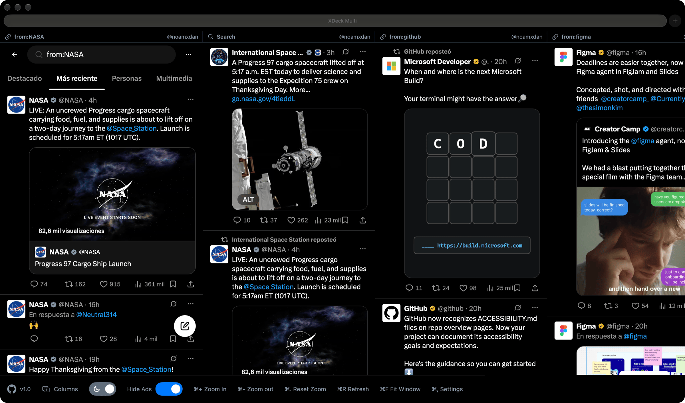
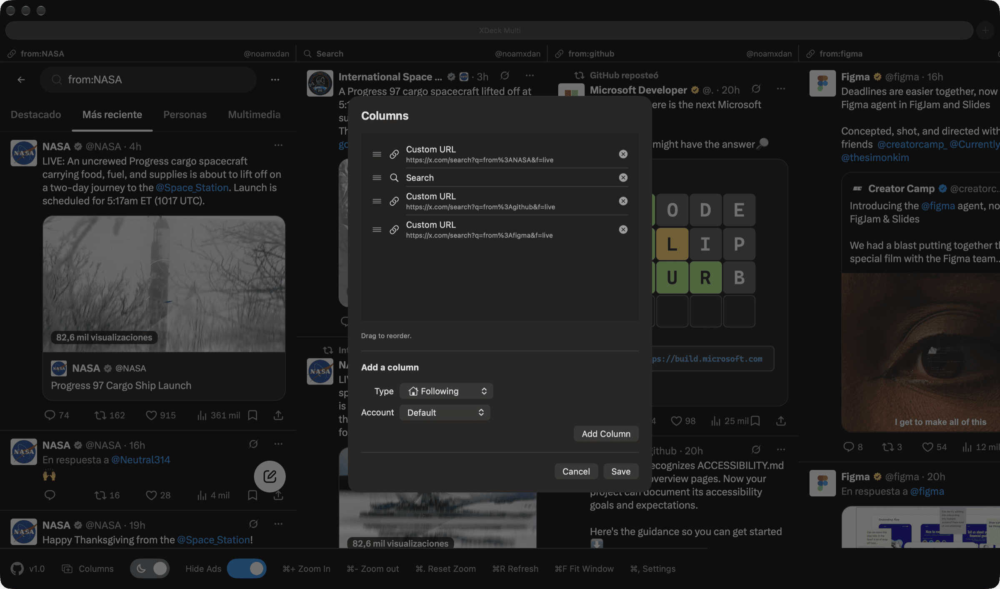
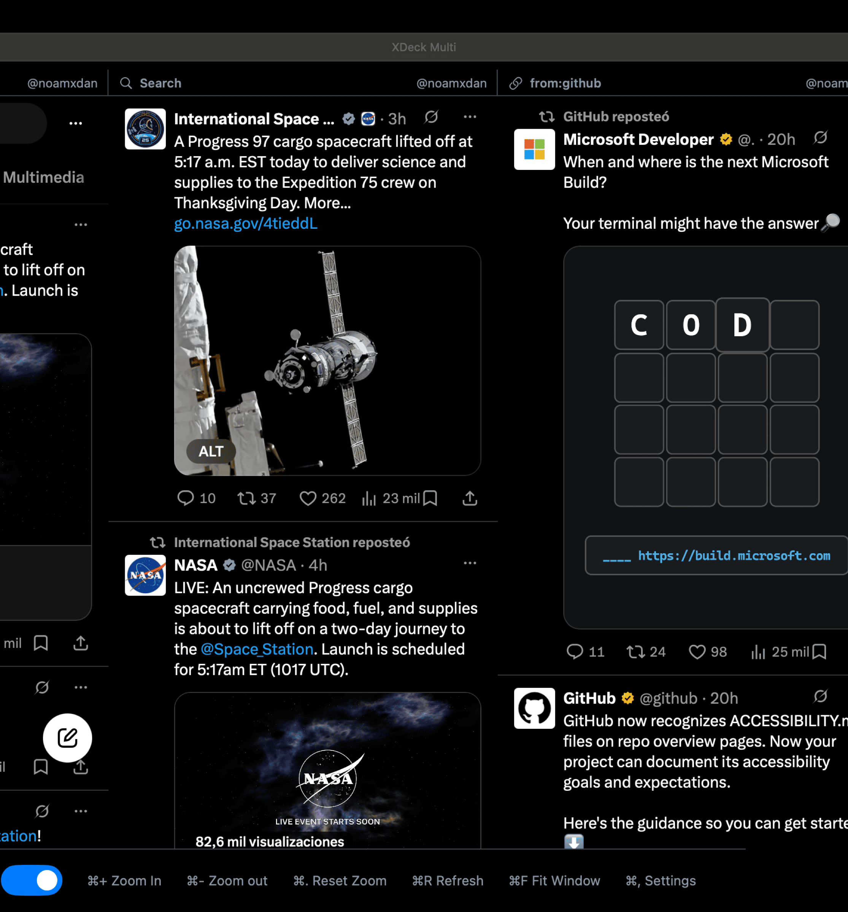

<div align="center">
  
  <h1>XDeck Multi</h1>
  <p><b>A TweetDeck-style 𝕏 client for macOS, Windows and Linux, with several accounts in one window.</b></p>
  <p><b>English</b> · <a href="README.es.md">Español</a></p>
  <a href="https://github.com/danielcamposlozada/XDeck-Multi/releases/latest"></a>
  
  <a href="https://github.com/danielcamposlozada/XDeck-Multi/actions/workflows/ci.yml"></a>
  <a href="LICENSE"></a>
  <br><br>
  
</div>

> [!NOTE]
> XDeck Multi is a fork of [XDeck](https://github.com/morishin/XDeck) by [Shintaro Morikawa](https://github.com/morishin). It adds multiple accounts, a column editor, a Search column and a Windows and Linux edition.

## Why XDeck Multi?

- **TweetDeck is gone for most people.** X Pro needs a paid plan. XDeck Multi shows your timeline, notifications, lists and searches side by side with a free account.
- **One window for every account.** Personal and work accounts each get their own columns, their own login and their own Post button. No more logging out and in.
- **No API keys, no server.** Each column is x.com itself, so everything X offers keeps working, and your data only goes to X.

## Features

### Columns
- For You, Following, Notifications, Profile, Search, and any 𝕏 page you want (a list, a search, a community).
- Search columns: type a query like `from:NASA` when adding a column and it shows the latest posts.
- **Columns** button: add, remove and reorder columns. Changes show up right away.
- Drag a column by its title bar to move it right in the window: the whole column follows the cursor and the others slide out of its way. Right-click a title bar to move it one place over. No page reloads while you rearrange.
- A title bar on each column with its type and account.
- Opening a photo or video expands that column to the full window.

### Multiple accounts
- Each column can use a different 𝕏 account.
- Every account keeps its own isolated, persistent session.
- Guided login, one account at a time, showing which account comes next, with a "Skip for Now" option.
- The first column of each account keeps the Post button, so you always post from the right account.

### Reading
- Hide ads and promoted posts with one switch.
- Light and dark mode.
- **Download videos and GIFs** with the ⬇︎ button on each one. They're saved to your Downloads folder in the best quality 𝕏 offers, with the progress on the button and in the toolbar.
- Zoom in and out of every column at once, and refresh them all, from the bottom toolbar or the keyboard.
- 𝕏's mobile navigation bar is hidden, so narrow columns show only posts.

## Gallery

#### Add and reorder columns


#### Searches as columns


## Installation

Download the file for your system from the [latest release](https://github.com/danielcamposlozada/XDeck-Multi/releases/latest).

| System | File |
|---|---|
| macOS 13.3 or later (Apple silicon and Intel) | `XDeck-Multi-<version>-macOS.zip` |
| Windows 10 or later | `XDeck-Multi-Setup-<version>.exe` |
| Linux (x86-64) | `XDeck-Multi-<version>-x86_64.AppImage` or `xdeck-multi_<version>_amd64.deb` |

### First launch

The apps aren't signed by Apple or Microsoft, so the first launch needs one extra step.

- **macOS:** unzip the file and move **XDeck Multi** to Applications. Open it once, then go to **System Settings → Privacy & Security** and click **Open Anyway**.
- **Windows:** if SmartScreen shows "Windows protected your PC", click **More info → Run anyway**.
- **Linux (AppImage):** make it executable with `chmod +x XDeck-Multi-*.AppImage` and open it. On Ubuntu 24.04 and Linux Mint 22 it needs FUSE 2: `sudo apt install libfuse2t64`.
- **Linux (.deb):** `sudo apt install ./xdeck-multi_*_amd64.deb`.

## Usage

### Keyboard shortcuts

On Windows and Linux, use Ctrl instead of ⌘.

| Shortcut | Action |
|---|---|
| ⌘ + / ⌘ − | Zoom in / out |
| ⌘ . | Reset zoom |
| ⌘ R | Refresh all columns |
| ⌘ F | Fit the window to the columns |
| ⌘ , | Open the settings folder |
| Alt ← / Alt → | Move the focused column's title bar left or right (Windows and Linux) |

### Configuration

The **Columns** button covers adding, removing and reordering columns. Everything else lives in `settings.json`: press ⌘, to open its folder, edit the file and restart the app.

```json
{
  "$schema": "./schema.json",
  "columnWidth": 400,
  "columns": [
    { "type": "forYou" },
    { "type": "search" },
    { "type": "custom", "url": "https://x.com/i/lists/123456789" },
    { "type": "following", "account": "work" },
    { "type": "notifications", "account": "work" }
  ]
}
```

| Field | Meaning |
|---|---|
| `columnWidth` | Width of every column in points. Leave it out to split the window evenly. |
| `type` | `forYou`, `following`, `notifications`, `profile`, `search` or `custom`. |
| `url` | For `custom` columns: any web address, such as a list or a search. |
| `account` | Optional name of the 𝕏 account for that column. Columns with the same name share one login; columns without it use the default login. Not case-sensitive. |

Where `settings.json` lives:

| System | Path |
|---|---|
| macOS | `~/Library/Containers/com.danielcamposlozada.XDeckMulti/Data/.config/XDeckMulti/` |
| Windows | `%APPDATA%\XDeckMulti\` |
| Linux | `~/.config/XDeckMulti/` |

## Requirements

- **macOS 13.3 or later.** Separate, persistent sessions for extra accounts need **macOS 14 or later**. On macOS 13 they last until you quit the app, because older WebKit can't keep more than one saved session.
- **Windows 10 or later**, 64-bit.
- **Linux** x86-64 with GTK 3.

## FAQ

**Does it use the 𝕏 API?**
No. Each column is x.com in a web view, and XDeck Multi only adjusts how the page looks. There are no API keys and no rate limits beyond the website's own.

**Is my password safe?**
You log in on x.com itself, inside the app. XDeck Multi never sees or stores your password. Sessions are kept on your computer, one per account.

**Passkeys don't work. Why?**
Passkeys only work in browsers, not inside other apps. Log in with your password and, if you use it, your two-factor code.

**A column stays empty or 𝕏 looks different.**
𝕏 changes its website often. Press ⌘R to refresh. If it's still broken, [open an issue](https://github.com/danielcamposlozada/XDeck-Multi/issues) with a screenshot.

**Can I use it next to the original XDeck?**
Yes. XDeck Multi has its own name, app identifier and settings folder.

## Building from source

### macOS

Needs Xcode 26 or later (the app icon uses the Icon Composer format).

```sh
git clone https://github.com/danielcamposlozada/XDeck-Multi.git
cd XDeck-Multi
xcodebuild -project XDeck.xcodeproj -scheme XDeck -configuration Release -derivedDataPath build \
  CODE_SIGN_STYLE=Manual CODE_SIGN_IDENTITY=- DEVELOPMENT_TEAM= build
open "build/Build/Products/Release/XDeck Multi.app"
```

### Windows and Linux

Needs Node.js 22.12 or later. See [`desktop/README.md`](desktop/README.md) for packaging.

```sh
cd desktop
npm ci
npm start
```

How the two editions work inside is explained in [`docs/ARCHITECTURE.md`](docs/ARCHITECTURE.md).

## Contributing

Bug reports and pull requests are welcome. Please open an issue first for larger changes. Both editions share the page scripts in [`shared/`](shared), and `npm run check` in `desktop/` verifies they match the macOS sources.

## Credits

- [XDeck](https://github.com/morishin/XDeck) by [Shintaro Morikawa](https://github.com/morishin), the app this fork is built on.
- Multiple accounts, column editor and the Windows and Linux edition by [Daniel Campos Lozada](https://noamdan.com).

## License

[MIT](LICENSE). XDeck Multi is not affiliated with 𝕏 Corp.
